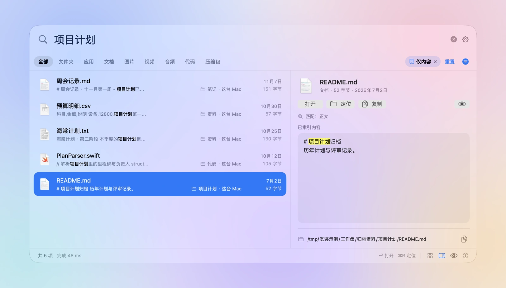
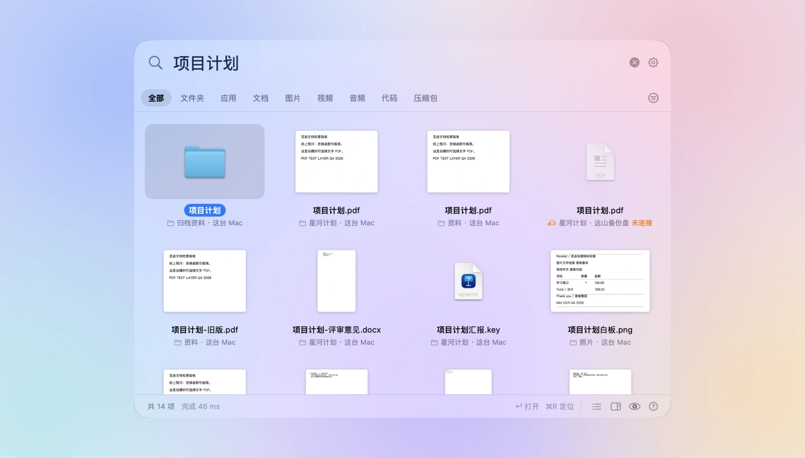

<p align="center">
  <picture>
    <source media="(prefers-color-scheme: dark)" srcset="docs/assets/intro-en-dark.svg">
    <source media="(prefers-color-scheme: light)" srcset="docs/assets/intro-en-light.svg">
    
  </picture>
</p>

<p align="center">
  <a href="https://github.com/kbwumin13-sudo/miji/releases/tag/v1.3.0"></a>
  
  
  
  <a href="LICENSE"></a>
</p>

<p align="center">
  <a href="https://github.com/kbwumin13-sudo/miji/releases/tag/v1.3.0"><b>Download Miji ↗</b></a> &nbsp; · &nbsp;
  <a href="#quick-start">Quick start</a> &nbsp; · &nbsp;
  <a href="#search-syntax">Search syntax</a> &nbsp; · &nbsp;
  <a href="README.md">简体中文</a>
</p>

**Miji (觅迹) is a native Mac search app built for Chinese file names and content.** Start with whatever you remember: part of a name, a phrase in a document, or a few words in a screenshot. Search names, pinyin, document text, image text and image labels from one box. Recognition, indexing and search run entirely on your Mac. The app interface is in Simplified Chinese.

## A little memory goes a long way

| You remember… | Try typing | Miji looks for… |
| --- | --- | --- |
| 海棠灌溉 (garden irrigation), without switching input methods | `htgg` / `haitang` | Chinese file names matched by pinyin initials or full pinyin |
| A plan mentioning 滴灌 (drip irrigation) | `滴灌 ext:pdf` | Text inside PDFs, including OCR from scanned pages |
| A screenshot with 花园计划 (garden plan) | `花园计划 kind:image` | Words recognized inside images |
| A bird photo named IMG-something | `鸟 kind:image` | Photos with locally recognized bird labels |

These examples use fictional materials.

**Unplug the drive. Keep the clues.** Once indexed, an external drive's file catalog, extracted text and image labels stay searchable. Find out where the file lives, then reconnect the right drive to open it.

<p align="center">
  <picture>
    <source media="(prefers-color-scheme: dark)" srcset="docs/assets/miji-1.3.0-40a1d67-search-dark.webp">
    <source media="(prefers-color-scheme: light)" srcset="docs/assets/miji-1.3.0-40a1d67-search-light.webp">
    
  </picture>
</p>
<p align="center"><sub>Captured from 1.3.0 / build 14 (40a1d67) with fictional files. Later core fixes leave the appearance unchanged. On-screen timings apply only to this sample.</sub></p>

## 1.3.0: find the clue, see the context

- **Older content gets a chance to surface**: content search no longer stops after filling a page solely from recently indexed files. Earlier content also enters candidate exploration; content matches are ranked by relevance and include snippets.
- **See where the search stands**: the interface shows search progress and whether a search budget limited the results. Changing the query prevents stale results from being acted on as current matches.
- **Filters you can see and remove**: active conditions are visible and individually removable, so it is clear what is narrowing the results.
- **Tell same-named files apart**: each result shows “parent folder · disk name.” Offline drives and unavailable original files have distinct messages to help you decide what to do next.
- **A native look that follows your Mac**: the interface follows the system's light or dark appearance, uses system Liquid Glass on macOS 26 and later, and retains a dark frosted-glass option.

Candidate exploration has time and decompression budgets; it does not guarantee a search of every indexed passage. If the interface reports limited results, add keywords or narrow the file type, path or location.

## Find it. Take a look. Keep going.

Select a result in the search window to check whether it is the one you need. The preview adapts to the result types, and you can also show or hide it manually.

- **Read the matching passage**: highlighted snippets explain the match; PDFs open at the matching page, with a separate reading window available.
- **Jump to the matching line**: code previews show line locations and can open them in VS Code, VS Code Insiders or Cursor when set as your default editor.
- **Browse pictures and play media**: switch between list and thumbnail grid; audio and video play on demand and stop when you switch results or close the preview.
- **Keep your hands on the keyboard**: `Return` opens, `⌘Return` reveals in Finder, `⌘C` copies the file, and `⌘⇧C` copies its path.

<details>
<summary>See filters, same-named files and the thumbnail grid</summary>

**Visible filters, clearer locations.** Switch file types, remove individual conditions or reset them. “Parent folder · disk name” tells you where each result lives; disconnected drives are marked offline.

<p align="center">
  <picture>
    <source media="(prefers-color-scheme: dark)" srcset="docs/assets/miji-1.3.0-40a1d67-filters-dark.webp">
    <source media="(prefers-color-scheme: light)" srcset="docs/assets/miji-1.3.0-40a1d67-filters-light.webp">
    
  </picture>
</p>

**Browse results visually.** The grid shows thumbnails, file names and locations for browsing pictures and documents.

<p align="center">
  <picture>
    <source media="(prefers-color-scheme: dark)" srcset="docs/assets/miji-1.3.0-40a1d67-grid-dark.webp">
    <source media="(prefers-color-scheme: light)" srcset="docs/assets/miji-1.3.0-40a1d67-grid-light.webp">
    
  </picture>
</p>

Both pairs also come from 1.3.0 / build 14 (40a1d67), using the same fictional dataset.

</details>

## Built for everyday searching

| Detail | In practice |
| --- | --- |
| **Less typing in Chinese** | Search with Chinese characters, full pinyin or initials. Exact and prefix matches rank higher. |
| **Results as you type** | Name matches arrive first, followed by content matches. Changing the query or closing the panel cancels stale work. |
| **Relevant results first** | Exact names, frequently used prefixes and pinyin matches get priority. Content ranks by phrase matches and term proximity, appearing alongside ordinary name matches. |
| **Pick up where you left off** | Incremental scans follow changed paths. Restarts restore the name cache and replay file events. |
| **Your files stay on your Mac** | No uploads or telemetry. OCR uses the built-in Apple Vision framework; indexing and search are local. |

Indexing starts at `/`, including accessible system folders, hidden files and Library. App bundles and document packages count as single items. Cloud placeholders are indexed by name without triggering downloads. Manage recognition categories and indexed locations in Settings; removing a location does not delete the original files.

## Quick start

**Apple Silicon · macOS 14 or later**

1. [Download Miji 1.3.0](https://github.com/kbwumin13-sudo/miji/releases/tag/v1.3.0), unzip `Miji-1.3.0-macOS-arm64.zip`, and drag 觅迹.app into Applications.
2. **First launch**: Miji is ad-hoc signed and not yet notarized by Apple. If macOS cannot verify the developer, try opening the app once, then choose **Open Anyway** in System Settings → Privacy & Security. If it says the app “is damaged,” confirm the archive came from this repository's Releases, then run:

   ```sh
   xattr -dr com.apple.quarantine /Applications/觅迹.app
   ```

3. Enable 觅迹 in System Settings → Privacy & Security → Full Disk Access, then reopen it to index protected folders such as Documents and Desktop.
4. Press **`⌃⌥Space`** (Control + Option + Space), or click the menu bar magnifier. The first run builds a searchable file-name catalog; image and document content follows in background batches. Check progress in 索引与设置 (Index & Settings).

A SHA-256 checksum file is included on the release page. Upgrades preserve your index, scan scope and settings, with no rebuild required.

<details>
<summary>All keyboard shortcuts</summary>

| Keys | Action |
| --- | --- |
| `⌃⌥Space` | Show / hide search |
| `↑` `↓` | Move selection |
| `Return` | Open |
| `⌘Return` / `⌘R` | Reveal in Finder |
| `⌘Y`, or `Space` with the result list focused | Quick Look |
| `⌘C` | Copy the selected file; text editing keeps native copy behavior |
| `⌘⇧C` | Copy path |
| `⌘F` | Return to the search field |
| `⌘,` | Index & Settings |
| `Esc` / `⌘W` | Hide |

The top tabs filter by file type. The filter menu controls name / content scope, indexed location and sort order.

</details>

<details>
<summary>How adaptive previews work</summary>

Automatic mode keeps application, folder, archive and other metadata-only searches in a compact list, while pictures, documents, code and media keep the content pane. The footer offers Automatic / Show / Hide, and an explicit choice persists across searches. The whole result set determines the layout, so selection changes and loading failures do not resize the window.

File actions and full-path copying stay visible while text and code scroll independently. Offline results use stored content; previews never automatically unpack, download or re-extract files.

</details>

## Search syntax

Start with a keyword. Add a filter when you need one.

| Query | Effect |
| --- | --- |
| `海棠灌溉` | Search names and content |
| `htgg` / `haitang` | Match names by pinyin initials / full pinyin |
| `花园 滴灌` | Match all words |
| `"alpha beta"` | Exact phrase |
| `ext:pdf` | Filter by extension |
| `path:演示` | Filter by path |
| `花园 -草稿` | Exclude results containing 草稿 |
| `kind:image 海棠` | Images only; also supports `document`, `folder`, `video`, `audio`, `code`, `archive`, `application` and their Chinese names |

Up to 500 results are shown. Narrow them down by type, location or more keywords.

## Supported content

| Content | Search coverage |
| --- | --- |
| Text in images | On-device Vision OCR: PNG, JPEG, HEIC, TIFF, BMP, GIF and WebP; first frame of animations |
| Image content | Vision classification labels and common Chinese aliases, such as bird, flower and beach; not free-form natural-language semantic search |
| PDF | Text extraction, with OCR for pages without a text layer, including scans |
| Word / PowerPoint / Excel | DOCX body, headers and footers; PPTX slides and notes; XLSX cells. Legacy DOC uses system conversion; PPT and XLS use system import |
| Pages / Numbers / Keynote | System parsing first, then embedded PDF or preview images as a fallback; partial extraction is flagged in the UI |
| Text and code | TXT, Markdown, CSV, HTML, RTF / RTFD, EPUB, common source and configuration files |
| External drives | Indexed names, text and labels remain searchable offline; opening or previewing original files requires reconnecting |

<details>
<summary>Extraction limits and preview compatibility</summary>

- Per-file limits: 64 MiB input, 8 MiB extracted text and 128 MiB total ZIP expansion. Files over a limit keep a note and remain searchable by name. Password-protected documents are not decrypted.
- OCR, PDF and iWork parsing run one file at a time in a separate helper process. A file that exceeds 180 seconds is stopped and logged; indexing continues with the next file.
- Older PDFs with a text layer locate matching pages on demand. Older scans retain their OCR text and gain page locations when re-extracted. Stale locations are disabled if a file changes before its index catches up.
- Media formats depend on macOS support. Offline content previews use stored text; original-file previews need the drive online.
- Full-text completeness for modern iWork formats has not been validated against a large real-world sample. Offline and reconnect behavior has been tested with APFS disk images; physical drive unplugging has not been tested systematically.

</details>

## Performance and verification

1.3.0 checks candidate coverage, ranking and latency on a fixed fictional dataset: 800 files and 24 tasks, including 6 held out. Relevance labels are provisional development labels, without user-validated real-world task judgments.

<details>
<summary>1.3.0 search quality: gains and tradeoffs</summary>

Success@5 means at least one directly relevant document appears in the first five results. Text, paths and modification times stay fixed; only insertion order changes. Both versions use the same labels:

| Insertion order | Previous Success@5 | 1.3.0 Success@5 |
| --- | ---: | ---: |
| Forward | 37.5% | 100.0% |
| Reverse | 37.5% | 100.0% |
| Fixed-seed shuffle | 45.8% | 100.0% |

- **A retained tradeoff**: one multi-document task's nDCG@10 fell from 1.000 to 0.920 while Success@5 stayed unchanged. This metric gives no repeated gain to copies of the same content, exposing room to improve result diversity.
- **CLI latency after review fixes, with warm caches**: median / P95 across all tasks changed from 35.51 / 96.07 ms to 39.94 / 114.63 ms. Name-only median / P95 changed from 0.249 / 0.294 ms to 0.243 / 0.657 ms. Old and new versions alternated for 6 rounds on the same machine and dataset; statistics use the last 5. Core timings exclude name loading, and system caches were not cleared. These are not app-startup or cold-disk measurements.
- **Optimized AppModel evaluation**: across the same 9 successful tasks, P95 time to the first relevant result fell from 94.46 ms to 39.52 ms. Across all tasks, P95 time until the first ten results were stable with snippets ready rose from 145.57 ms to 158.86 ms. This used an optimized, testing-enabled bundle: the last 5 of 6 alternating rounds, 120 task runs per version. It measures model publication, not pixel rendering; old tasks with no relevant result are not recorded as zero latency.
- **Coverage remains bounded**: many duplicates, content indexed in the middle of the sequence, very long documents, or relevant passages late in a file may still be missed or rank lower because of budgets and limited text windows. The results apply to this dataset, not full-index recall or real-user task accuracy.

See the [search quality and interface evaluation](docs/search-quality-review.md) for methods, reproduction steps and limitations (in Chinese).

</details>

**Verification status**: the final full test run contained 231 tests: 228 passed, 2 skipped, and 1 existing isolated-extraction test failed. That test passed on its own, as did all 11 tests in the isolated-extraction suite; the original failure's cause remains unconfirmed. The standard Release after the fixes passed 52/52 end-to-end checks. See the [full report](docs/search-quality-review.md) for details and untested hands-on combinations.

The historical records below retain their original test conditions. They describe earlier index sizes and resource use, not new measurements of 1.3.0.

<details>
<summary>Benchmarks: name queries, memory and index size</summary>

1.1.0 · Apple M5 / 16 GB · 2,479,232 file names · 20 runs per query. P95 ranged from 9.7–77.5 ms across six Chinese, pinyin, initials and English queries. This includes name matching and result reads, not full-text search or initial indexing. Only aggregate results are retained here, without the original query strings.

- **Index size (1.1.0)**: the same index shrank from 51.07 GB to 7.28 GB through SHA-256 text deduplication and lossless LZFSE compression; all 840,123 extracted records were verified during migration.
- **Name cache restore (1.1.5)**: about 0.2–0.6 seconds for 3.54 million files, without a rescan.
- **Main-process resident memory (1.1.5)**: about 25–50 MB on an index of 3.54 million files, excluding per-file OCR / document helpers. The 1.1.4 comparison was 233–373 MB.
- **Scan CPU (1.1.5)**: a quarter to a third of the previous CPU time on the same folder tree, with identical scan results.

</details>

## Under the hood

SwiftUI / AppKit provide the native interface, Apple Vision recognizes images, and SQLite stores the catalog and full-text index. Name and content search return results in parallel; FSEvents drives incremental indexing in the background.

<details>
<summary>Architecture and modules</summary>

| Module | Responsibility |
| --- | --- |
| `MijiApp` | Search panel, menu bar, hotkey, settings, file previews and Quick Look |
| `MijiCore` | Scanning, FSEvents, SQLite / FTS5, extraction, content-evidence ranking and shared result merging |
| `CContentIndex` | `miji_grams` tokenizer: 1–3 character grams recall candidates, then verify against the original text |
| `OilFindCore` / `COilFind` | Oil Find's MIT name core and pinyin tables, extended with compact name columns and binary snapshots |
| `MijiCLI` | CLI and bundled single-file extraction helper `miji-extract` |

The index lives in `~/Library/Application Support/Miji/`, with directory access restricted to your user account. Image recognition, document text and external-drive processing can each be disabled; indexed content is retained.

</details>

<details>
<summary>Build from source</summary>

Building requires Xcode 26 or later with the macOS 26 SDK for the Liquid Glass APIs. The app still runs on macOS 14 and later, using a fallback material on earlier systems.

```sh
git clone https://github.com/kbwumin13-sudo/miji.git
cd miji
swift test                                               # Core and App tests
bash scripts/package.sh                                  # Release build, signing and packaging
python3 scripts/e2e-check.py --cli .build/release/miji-cli   # End-to-end checks
```

Packages are written to `output/`. Source may contain unreleased changes; use Releases for everyday use.

</details>

Missing a file, seeing a preview issue, or have an idea? [Open an issue](https://github.com/kbwumin13-sudo/miji/issues) with your macOS version, Miji version and steps to reproduce. Remove private information from sample files first.

## Credits and license

The name-matching core and pinyin tables come from [Oil Find](https://github.com/oil-oil/oil-find) v1.6.2 (MIT, Copyright © 2026 Lin Zhihuang). See [UPSTREAM.md](Vendor/OilFind/UPSTREAM.md) for the pinned commit and local changes. The panel's interaction design draws on Oil Find and macOS Spotlight.

Miji is open source under the [MIT License](LICENSE). `Vendor/OilFind` retains its [original MIT license](Vendor/OilFind/LICENSE), included in the app bundle.

<p align="center"><b>Less folder digging. More time for what you opened your Mac to do.</b><br><a href="https://github.com/kbwumin13-sudo/miji/releases/tag/v1.3.0">Download Miji ↗</a></p>
