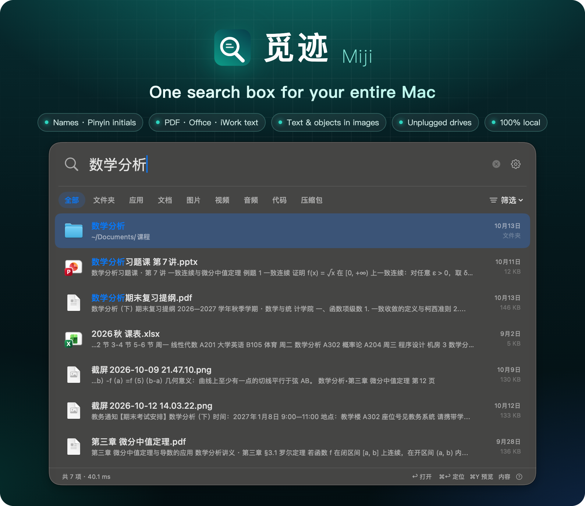
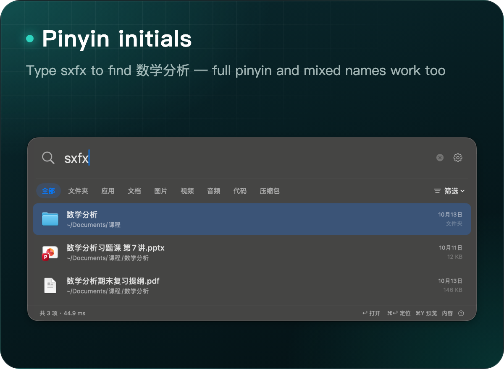
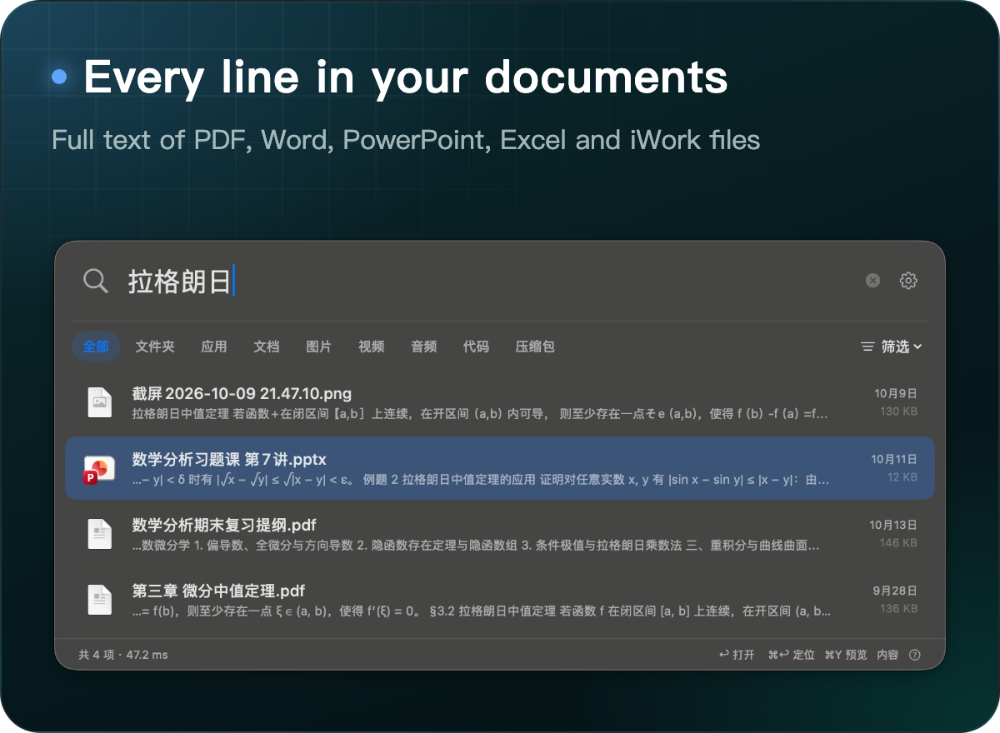
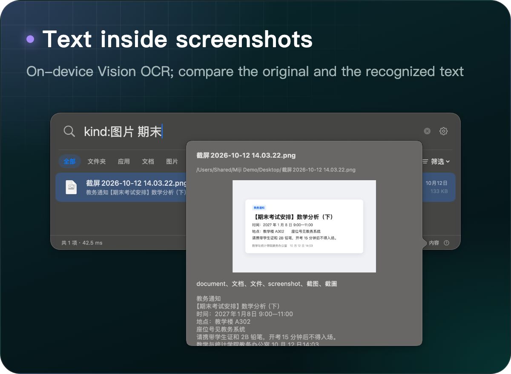
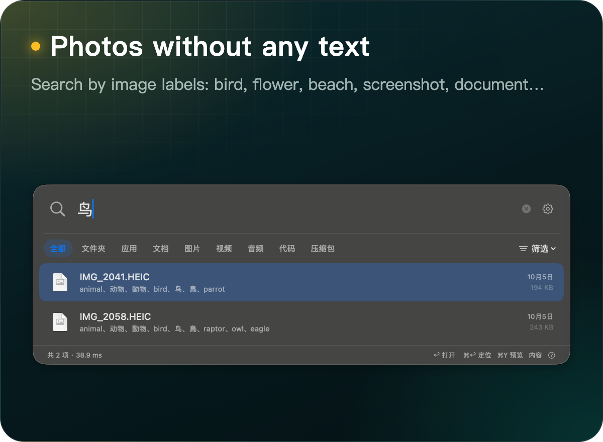
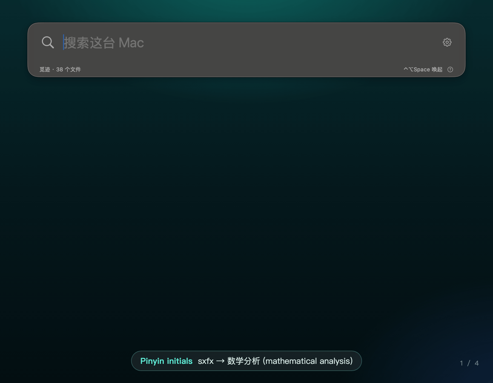
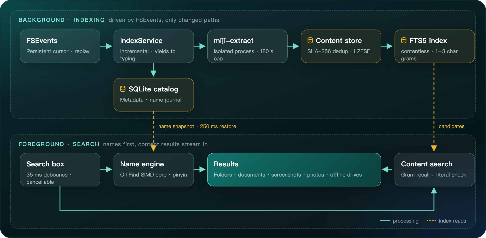

<p align="center">
  
</p>

<p align="center">
  <a href="https://github.com/kbwumin13-sudo/miji/releases/latest"></a>
  
  
  
  
  <a href="LICENSE"></a>
</p>

<p align="center">
  <a href="https://github.com/kbwumin13-sudo/miji/releases/latest"><b>Download</b></a> ·
  <a href="#quick-start"><b>Quick start</b></a> ·
  <a href="#search-syntax"><b>Search syntax</b></a> ·
  <a href="#performance"><b>Performance</b></a> ·
  <a href="#how-it-works"><b>How it works</b></a> ·
  <a href="README.md"><b>简体中文</b></a>
</p>

Press `⌃⌥Space`, type `sxfx` to open your 数学分析 (mathematical analysis) notes, type 拉格朗日 to surface a lecture screenshot, or type 鸟 (bird) to find a parrot photo that contains no text at all.

**Miji** (觅迹, "seeking traces") is a native macOS search tool built for Chinese-speaking users. File names, pinyin and initials, the full text of PDF and Office documents, text and objects inside images, and drives you have already unplugged all live behind one search box. Recognition, indexing and search run entirely on your Mac, with no network access. The interface is in Simplified Chinese.

## What it finds

<p align="center">
  
  
</p>
<p align="center">
  
  
</p>

- **The whole Mac by default**: indexing starts at `/`, including system folders, hidden files and Library; app bundles and document packages count as single items.
- **Unplugged drives stay searchable**: each external drive is indexed separately by volume UUID. After you disconnect it, names, text and labels remain on your Mac and results are marked 未连接 (offline); reconnecting restores the drive even if its mount path changed.
- **Results while you type**: name matches appear first, content matches stream in, and stale queries are cancelled as soon as you keep typing or close the panel.
- **Your files first**: exact and prefix matches rank higher, your own files come before Library, system and dependency folders, and files you recently opened from Miji move up.
- **Only changes get rescanned**: a persistent FSEvents cursor limits rescans to changed paths and replays history after a restart; a full rescan happens only if events were lost.
- **One bad file never stalls the index**: OCR, PDF and iWork parsing run file by file in a bundled helper process; any file that takes longer than 180 seconds is stopped and logged while indexing moves on.

## Live demo

<p align="center">
  
</p>
<p align="center"><sub>The demo files are fictional course materials; the interface, results and timings come from Miji 1.1.0 running on a real Mac.</sub></p>

## Quick start

1. Download `Miji-1.1.5-macOS-arm64.zip` from [Releases](https://github.com/kbwumin13-sudo/miji/releases/latest), unzip it and drag 觅迹.app into Applications.
2. Miji is ad-hoc signed and not yet notarized, so macOS refuses the first launch, saying either that the developer cannot be verified or that the app "is damaged". Run the command below and open it again. If macOS only says it cannot verify the developer, you can instead try opening the app once, then click **Open Anyway** at the bottom of System Settings → Privacy & Security.

   ```sh
   xattr -dr com.apple.quarantine /Applications/觅迹.app
   ```

3. Enable 觅迹 in System Settings → Privacy & Security → Full Disk Access and reopen it so protected folders such as Documents and Desktop are indexed.
4. Press `⌃⌥Space`, or click the magnifier in the menu bar. The first run builds the file-name catalog (searchable while it grows); image and document content is recognized in the background, with progress shown in 索引与设置 (Index & Settings).

Requirements: Apple Silicon, macOS 14 or later.

### Keyboard shortcuts

| Keys | Action |
| --- | --- |
| `⌃⌥Space` | Show / hide search |
| `↑` `↓` | Move the selection |
| `Return` | Open |
| `⌘Return` or `⌘R` | Reveal in Finder |
| `⌘Y`, or `Space` while the result list has focus | Quick Look |
| `⌘⇧C` | Copy path |
| `⌘F` | Back to the search field |
| `⌘,` | Index & Settings |
| `Esc` or `⌘W` | Hide |

## Search syntax

| Query | Matches |
| --- | --- |
| `数学分析` | Chinese file names, pinyin, initials and content |
| `sxfx` / `shuxue` | Pinyin initials / full pinyin |
| `数学 期末` | Every word must match |
| `"alpha beta"` | Exact phrase |
| `ext:pdf` | File extension |
| `path:课程` | Path contains |
| `数学 -草稿` | Exclude results containing 草稿 |
| `kind:image 海棠` | Images only; `document`, `folder`, `video`, `audio`, `code`, `archive`, `application` and their Chinese names also work |

Up to 500 results are shown; narrow them down by kind, location or more words.

## Supported content

| Content | Coverage |
| --- | --- |
| Text in images | On-device Apple Vision OCR for PNG, JPEG, HEIC, TIFF, BMP, GIF and WebP (first frame of animations) |
| Image content | Vision classification labels plus common Chinese aliases (bird, flower, beach, screenshot, document…) |
| PDF | Text layer, with OCR for pages that have none, so scanned PDFs are searchable |
| Word / PowerPoint / Excel | DOCX body, headers and footers; PPTX slides and notes; XLSX cells. Legacy DOC is converted by macOS; PPT and XLS go through the system importer |
| Pages / Numbers / Keynote | Parsed by macOS first; otherwise text comes from the embedded PDF or preview image, which may be partial and is flagged in the UI |
| Other documents | TXT, Markdown, CSV, HTML, RTF / RTFD, EPUB, common source and config files |
| External drives | Names, text and labels stay on your Mac and remain searchable while the drive is unplugged |

Per-file limits: 64 MiB of input, 8 MiB of extracted text, 128 MiB of total ZIP expansion. Files over a limit keep a note and remain searchable by name. Cloud placeholders that are not downloaded are indexed by name only and never downloaded; password-protected documents are not decrypted.

## Performance

Measured with 1.1.0 on an Apple M5 (16 GB RAM) against 2,479,232 real file names, 20 runs per query, P95 of name matching plus reading the results:

| Query | Kind | P95 |
| --- | --- | ---: |
| `数学分析` | Chinese | 9.7 ms |
| `数学` | Short Chinese | 19.5 ms |
| `shuxue` | Full pinyin | 28.9 ms |
| `sx` | Initials | 49.1 ms |
| `pdf` | English | 70.1 ms |
| `README` | English | 77.5 ms |

- **86% smaller index**: 1.1.0 deduplicates extracted text by SHA-256, compresses it losslessly with LZFSE, and stops storing text a second time inside the full-text index. The same index shrank from 51.07 GB to 7.28 GB; all 840,123 extracted records were verified one by one during the migration.
- **Ready after restart**: the name index cache is mapped straight into memory; 3.54 million files restore in about 0.2–0.6 seconds, with no rescan.
- **Memory**: on an index of 3.54 million files, the 1.1.5 main process stays at about 25–50 MB (233–373 MB in 1.1.4); OCR and document parsing run in per-file helpers that are not included in that figure.
- **Lighter scanning**: 1.1.5 makes fewer system calls per item, cutting scan CPU time to a quarter to a third for the same folder tree with identical results.
- **Broad full-text queries**: sorted by relevance, verification stops once a page of 500 matches is full. Common words such as 数学 or 报告 take about 1–8 seconds; very common words such as `README` or `OCR` can still exceed 10 seconds. Name results and verified content matches appear first.

## How it works

<p align="center">
  
</p>

| Module | Responsibility |
| --- | --- |
| `MijiApp` | SwiftUI / AppKit panel, menu bar item, global hotkey, settings and Quick Look |
| `MijiCore` | Scanning, FSEvents incremental updates, SQLite catalog and FTS5, extraction scheduling, index migration |
| `CContentIndex` | Custom FTS5 tokenizer `miji_grams`: 1–3 character grams only recall candidates, which are then verified against the original text |
| `OilFindCore` / `COilFind` | MIT-licensed name core from Oil Find v1.6.2 (SIMD byte matching and pinyin tables), extended by Miji with compact name columns and binary snapshots |
| `MijiCLI` | Command-line tool, also bundled as the single-file extraction helper `miji-extract` |

## Privacy

- The source code makes no network requests: no uploads, no analytics.
- The index lives in `~/Library/Application Support/Miji/`, readable and writable only by your user account.
- OCR uses Apple's Vision framework on your Mac.
- Image recognition, document text and external-drive processing can each be turned off in settings; existing results are kept.
- Removing an indexed location deletes only its index, never your files.

## Build from source

Requires macOS 14+ and the Swift 5.9 toolchain (Xcode 15 or later).

```sh
git clone https://github.com/kbwumin13-sudo/miji.git
cd miji
swift test                                                   # Core and App tests
bash scripts/package.sh                                      # Release build, signing and zip in output/
python3 scripts/e2e-check.py --cli .build/release/miji-cli   # End-to-end check
```

Before the 1.1.5 release, all 181 Core tests (one large benchmark is skipped by default) and 7 App tests passed, and the release CLI passed 52/52 end-to-end checks covering OCR, PDF, DOCX, pinyin and filter syntax, plus offline and reconnect behavior of external drives simulated with APFS disk images.

## Limitations

- Apple Silicon only; macOS 14 or later.
- Ad-hoc signed and not notarized, so the first launch needs manual approval.
- Image search uses Vision classification labels; it is not free-form semantic search.
- Full-text completeness for modern Pages, Numbers and Keynote files has not been validated against a large set of real documents.
- Offline and reconnect behavior is tested with APFS disk images; physically unplugging real drives has not been tested systematically.

## Acknowledgments

The name-matching core and pinyin tables come from [Oil Find](https://github.com/oil-oil/oil-find) v1.6.2 (MIT License, Copyright © 2026 Lin Zhihuang). The pinned commit and local changes are documented in [Vendor/OilFind/UPSTREAM.md](Vendor/OilFind/UPSTREAM.md). The search panel's interaction design draws on Oil Find and macOS Spotlight.

## License

Miji is released under the [MIT License](LICENSE). Code in `Vendor/OilFind` keeps its original [MIT License](Vendor/OilFind/LICENSE), which ships inside the app bundle.
