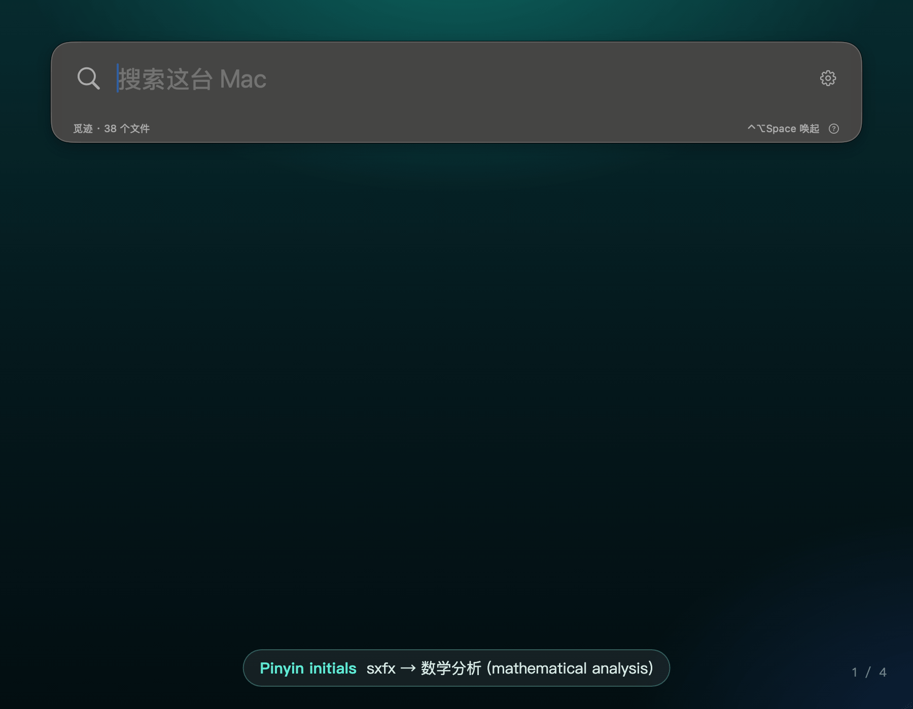
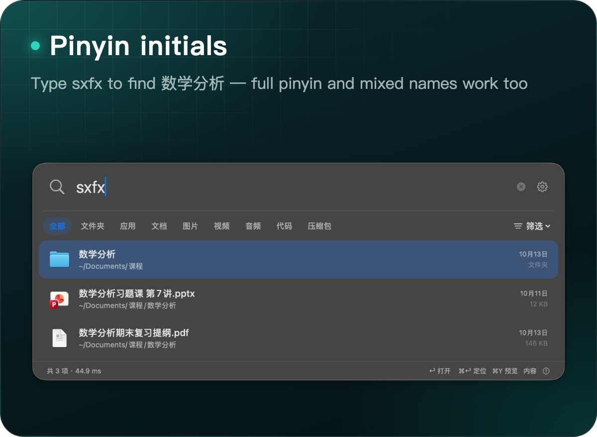
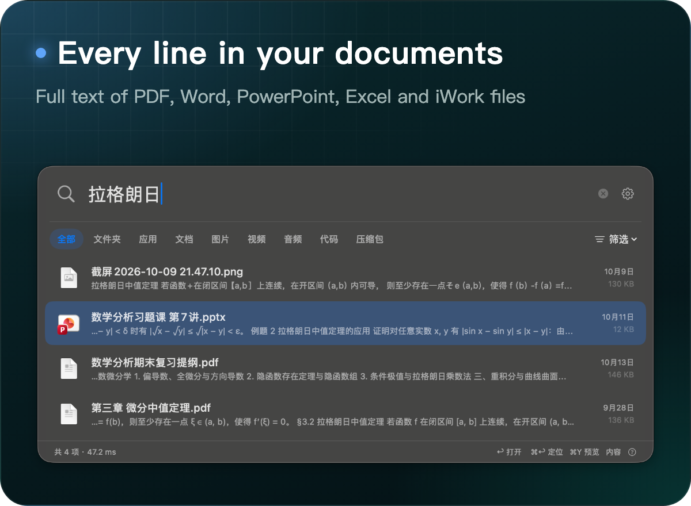
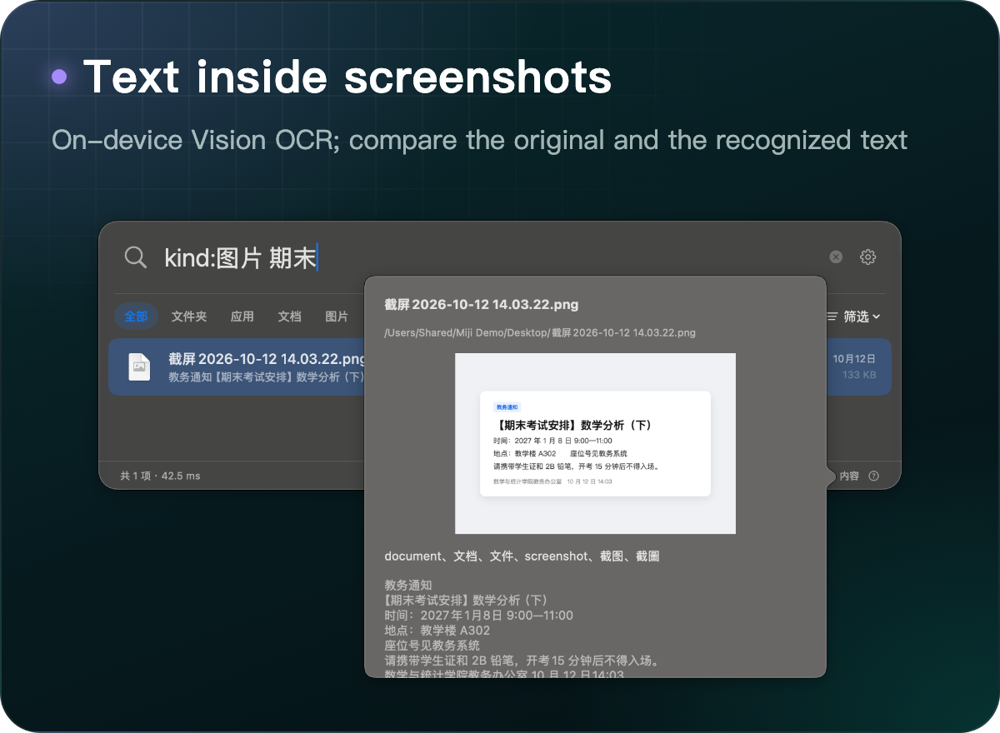
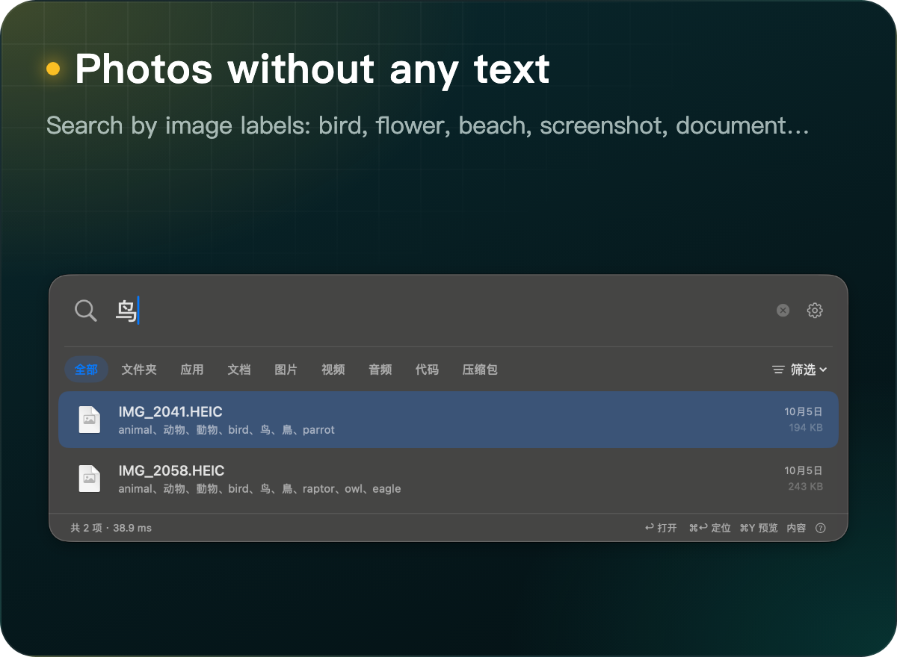
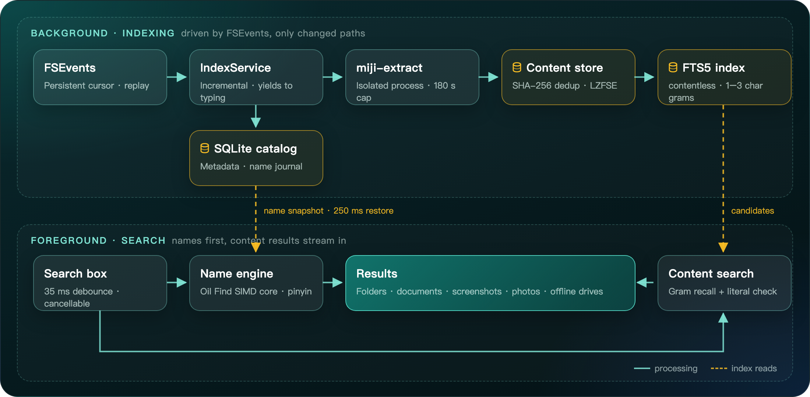

<p align="center">
  <picture>
    <source media="(prefers-color-scheme: dark)" srcset="docs/assets/intro-en-dark.svg">
    <source media="(prefers-color-scheme: light)" srcset="docs/assets/intro-en-light.svg">
    
  </picture>
</p>

<p align="center">
  <a href="https://github.com/kbwumin13-sudo/miji/releases/latest"></a>
  
  
  
  <a href="LICENSE"></a>
</p>

<p align="center">
  <a href="https://github.com/kbwumin13-sudo/miji/releases/latest"><b>Download Miji ↗</b></a> &nbsp; · &nbsp;
  <a href="#quick-start">Quick start</a> &nbsp; · &nbsp;
  <a href="#search-syntax">Search syntax</a> &nbsp; · &nbsp;
  <a href="README.md">简体中文</a>
</p>

**Miji (觅迹) is a native Mac search app built for Chinese file names and content.** Start with whatever you remember: part of a name, a phrase in a document, or a few words in a screenshot. Search names, pinyin, document text, image text and image labels from one box. Recognition, indexing and search run entirely on your Mac. The app interface is in Simplified Chinese.

## A little memory goes a long way

| You remember… | Try typing | Miji looks for… |
| --- | --- | --- |
| 数学分析, without switching input methods | `sxfx` / `shuxue` | Chinese file names matched by pinyin initials or full pinyin |
| A lecture mentioning 拉格朗日 (Lagrange) | `拉格朗日 ext:pdf` | Text inside PDFs, including OCR from scanned pages |
| A screenshot with 考试安排 (exam schedule) | `考试安排 kind:image` | Words recognized inside images |
| A bird photo named IMG-something | `鸟 kind:image` | Photos with locally recognized bird labels |

**Unplug the drive. Keep the clues.** Once indexed, an external drive's file catalog, extracted text and image labels stay searchable. Find out where the file lives, then reconnect the right drive to open it.

<p align="center">
  
</p>
<p align="center"><sub>Recorded with 1.1.0 using fictional course materials; the interface, results and timings are from an actual run. The previews added in 1.2.0 are described below.</sub></p>

## Find it. Take a look. Keep going.

[1.2.0](docs/releases/1.2.0.md) brings file previews into the search window. Select a result to check whether it is the one you need.

- **Read the matching passage**: highlighted snippets explain the match; PDFs open at the matching page, with a separate reading window available.
- **Jump to the matching line**: code previews show line locations and can open them in VS Code, VS Code Insiders or Cursor when set as your default editor.
- **Browse pictures and play media**: switch between list and thumbnail grid; audio and video play on demand and stop when you switch results or close the preview.
- **Keep your hands on the keyboard**: `Return` opens, `⌘Return` reveals in Finder, `⌘C` copies the file, and `⌘⇧C` copies its path.

<details>
<summary>See pinyin, full-text, OCR and image-label search in action</summary>

<p>
  
  
</p>
<p>
  
  
</p>

These feature images use fictional course materials in 1.1.0. They do not show the newer preview layout.

</details>

## Built for everyday searching

| Detail | In practice |
| --- | --- |
| **Less typing in Chinese** | Search with Chinese characters, full pinyin or initials. Exact and prefix matches rank higher. |
| **Results as you type** | Name matches arrive first, followed by content matches. Changing the query or closing the panel cancels stale work. |
| **Your files first** | Personal files rank above system, Library and dependency folders; files recently opened through Miji move up. |
| **Pick up where you left off** | Incremental scans follow changed paths. Restarts restore the name cache and replay file events. |
| **Your files stay on your Mac** | No uploads or telemetry. OCR uses the built-in Apple Vision framework; indexing and search are local. |

Indexing starts at `/`, including accessible system folders, hidden files and Library. App bundles and document packages count as single items. Cloud placeholders are indexed by name without triggering downloads. Manage recognition categories and indexed locations in Settings; removing a location does not delete the original files.

## Quick start

**Apple Silicon · macOS 14 or later**

1. [Download the latest release](https://github.com/kbwumin13-sudo/miji/releases/latest), unzip `Miji-1.2.0-macOS-arm64.zip`, and drag 觅迹.app into Applications.
2. **First launch**: Miji is ad-hoc signed and not yet notarized by Apple. If macOS cannot verify the developer, try opening the app once, then choose **Open Anyway** in System Settings → Privacy & Security. If it says the app “is damaged,” confirm the archive came from this repository's Releases, then run:

   ```sh
   xattr -dr com.apple.quarantine /Applications/觅迹.app
   ```

3. Enable 觅迹 in System Settings → Privacy & Security → Full Disk Access, then reopen it to index protected folders such as Documents and Desktop.
4. Press **`⌃⌥Space`** (Control + Option + Space), or click the menu bar magnifier. The first run builds a searchable file-name catalog; image and document content follows in background batches. Check progress in 索引与设置 (Index & Settings).

A SHA-256 checksum file is included on the release page. Upgrades preserve your index, scan scope and settings, with no rebuild required.

<details>
<summary>All keyboard shortcuts</summary>

| Keys | Action |
| --- | --- |
| `⌃⌥Space` | Show / hide search |
| `↑` `↓` | Move selection |
| `Return` | Open |
| `⌘Return` / `⌘R` | Reveal in Finder |
| `⌘Y`, or `Space` with the result list focused | Quick Look |
| `⌘C` | Copy the selected file; text editing keeps native copy behavior |
| `⌘⇧C` | Copy path |
| `⌘F` | Return to the search field |
| `⌘,` | Index & Settings |
| `Esc` / `⌘W` | Hide |

The top tabs filter by file type. The filter menu controls name / content scope, indexed location and sort order.

</details>

<details>
<summary>Coming from source: 1.2.1 adaptive previews (not in the 1.2.0 download)</summary>

Automatic mode keeps application, folder, archive and other metadata-only searches in a compact list, while pictures, documents, code and media keep the content pane. The footer offers Automatic / Show / Hide, and an explicit choice persists across searches. The whole result set determines the layout, so selection changes and loading failures do not resize the window.

File actions and full-path copying stay visible while text and code scroll independently. Offline results use stored content; previews never automatically unpack, download or re-extract files.

</details>

## Search syntax

Start with a keyword. Add a filter when you need one.

| Query | Effect |
| --- | --- |
| `数学分析` | Search names and content |
| `sxfx` / `shuxue` | Match names by pinyin initials / full pinyin |
| `数学 期末` | Match all words |
| `"alpha beta"` | Exact phrase |
| `ext:pdf` | Filter by extension |
| `path:课程` | Filter by path |
| `数学 -草稿` | Exclude results containing 草稿 |
| `kind:image 海棠` | Images only; also supports `document`, `folder`, `video`, `audio`, `code`, `archive`, `application` and their Chinese names |

Up to 500 results are shown. Narrow them down by type, location or more keywords.

## Supported content

| Content | Search coverage |
| --- | --- |
| Text in images | On-device Vision OCR: PNG, JPEG, HEIC, TIFF, BMP, GIF and WebP; first frame of animations |
| Image content | Vision classification labels and common Chinese aliases, such as bird, flower and beach; not free-form natural-language semantic search |
| PDF | Text extraction, with OCR for pages without a text layer, including scans |
| Word / PowerPoint / Excel | DOCX body, headers and footers; PPTX slides and notes; XLSX cells. Legacy DOC uses system conversion; PPT and XLS use system import |
| Pages / Numbers / Keynote | System parsing first, then embedded PDF or preview images as a fallback; partial extraction is flagged in the UI |
| Text and code | TXT, Markdown, CSV, HTML, RTF / RTFD, EPUB, common source and configuration files |
| External drives | Indexed names, text and labels remain searchable offline; opening or previewing original files requires reconnecting |

<details>
<summary>Extraction limits and preview compatibility</summary>

- Per-file limits: 64 MiB input, 8 MiB extracted text and 128 MiB total ZIP expansion. Files over a limit keep a note and remain searchable by name. Password-protected documents are not decrypted.
- OCR, PDF and iWork parsing run one file at a time in a separate helper process. A file that exceeds 180 seconds is stopped and logged; indexing continues with the next file.
- Older PDFs with a text layer locate matching pages on demand. Older scans retain their OCR text and gain page locations when re-extracted. Stale locations are disabled if a file changes before its index catches up.
- Media formats depend on macOS support. Offline content previews use stored text; original-file previews need the drive online.
- Full-text completeness for modern iWork formats has not been validated against a large real-world sample. Offline and reconnect behavior has been tested with APFS disk images; physical drive unplugging has not been tested systematically.

</details>

## Performance and verification

Name search responds first, with full-text matches arriving in batches. Broad content queries take longer: earlier tests measured about 1–8 seconds for common words such as 数学 or 报告, while very common terms such as `README` or `OCR` could exceed 10 seconds.

The records below are tied to the versions tested. **They are not benchmarks of the latest release or promises for every device.**

<details>
<summary>Benchmarks: name queries, memory and index size</summary>

1.1.0 · Apple M5 / 16 GB · 2,479,232 real file names · 20 runs per query. P95 includes name matching and result reads, not full-text search or initial indexing.

| Query | Kind | P95 |
| --- | --- | ---: |
| `数学分析` | Chinese | 9.7 ms |
| `数学` | Short Chinese | 19.5 ms |
| `shuxue` | Full pinyin | 28.9 ms |
| `sx` | Initials | 49.1 ms |
| `pdf` | English | 70.1 ms |
| `README` | English | 77.5 ms |

- **Index size (1.1.0)**: the same index shrank from 51.07 GB to 7.28 GB through SHA-256 text deduplication and lossless LZFSE compression; all 840,123 extracted records were verified during migration.
- **Name cache restore (1.1.5)**: about 0.2–0.6 seconds for 3.54 million files, without a rescan.
- **Main-process resident memory (1.1.5)**: about 25–50 MB on an index of 3.54 million files, excluding per-file OCR / document helpers. The 1.1.4 comparison was 233–373 MB.
- **Scan CPU (1.1.5)**: a quarter to a third of the previous CPU time on the same folder tree, with identical scan results.

</details>

[1.2.0 release verification](docs/releases/1.2.0.md): 186 Core tests passed, one optional large benchmark skipped, and 19 App tests passed. Hands-on checks covered scanned-PDF page locations and highlights, code line navigation, thumbnail grids, DOCX previews and H.264/AAC playback. The 1.1.5 CLI end-to-end suite passed 52/52 checks.

## Under the hood

SwiftUI / AppKit provide the native interface, Apple Vision recognizes images, and SQLite stores the catalog and full-text index. Name and content search return results in parallel; FSEvents drives incremental indexing in the background.

<details>
<summary>Architecture and modules</summary>

<p></p>

The cache-restore timing in the diagram is from an earlier measurement. See the benchmark above for dataset size and version.

| Module | Responsibility |
| --- | --- |
| `MijiApp` | Search panel, menu bar, hotkey, settings, file previews and Quick Look |
| `MijiCore` | Scanning, FSEvents, SQLite / FTS5, extraction scheduling and index migration |
| `CContentIndex` | `miji_grams` tokenizer: 1–3 character grams recall candidates, then verify against the original text |
| `OilFindCore` / `COilFind` | Oil Find's MIT name core and pinyin tables, extended with compact name columns and binary snapshots |
| `MijiCLI` | CLI and bundled single-file extraction helper `miji-extract` |

The index lives in `~/Library/Application Support/Miji/`, with directory access restricted to your user account. Image recognition, document text and external-drive processing can each be disabled; indexed content is retained.

</details>

<details>
<summary>Build from source</summary>

Requires macOS 14+ and the Swift 5.9 toolchain (Xcode 15 or later).

```sh
git clone https://github.com/kbwumin13-sudo/miji.git
cd miji
swift test                                               # Core and App tests
bash scripts/package.sh                                  # Release build, signing and packaging
python3 scripts/e2e-check.py --cli .build/release/miji-cli   # End-to-end checks
```

Packages are written to `output/`. Source may contain unreleased changes; use Releases for everyday use.

</details>

Missing a file, seeing a preview issue, or have an idea? [Open an issue](https://github.com/kbwumin13-sudo/miji/issues) with your macOS version, Miji version and steps to reproduce. Remove private information from sample files first.

## Credits and license

The name-matching core and pinyin tables come from [Oil Find](https://github.com/oil-oil/oil-find) v1.6.2 (MIT, Copyright © 2026 Lin Zhihuang). See [UPSTREAM.md](Vendor/OilFind/UPSTREAM.md) for the pinned commit and local changes. The panel's interaction design draws on Oil Find and macOS Spotlight.

Miji is open source under the [MIT License](LICENSE). `Vendor/OilFind` retains its [original MIT license](Vendor/OilFind/LICENSE), included in the app bundle.

<p align="center"><b>Less folder digging. More time for what you opened your Mac to do.</b><br><a href="https://github.com/kbwumin13-sudo/miji/releases/latest">Download Miji ↗</a></p>
