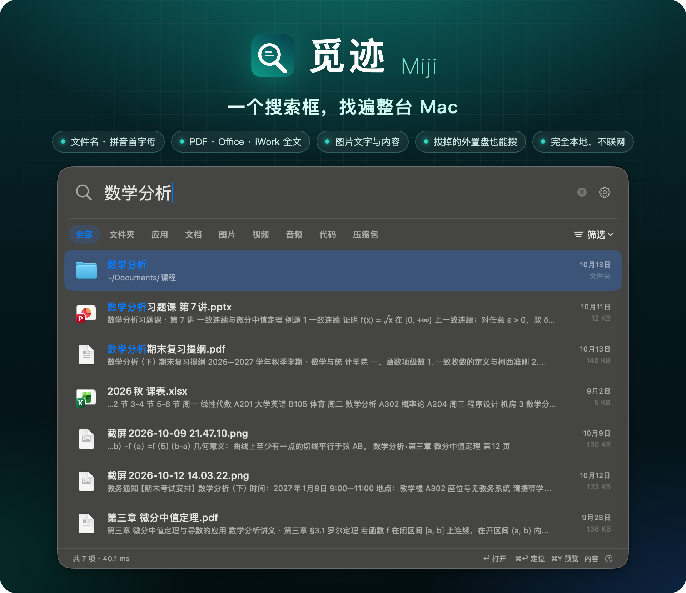
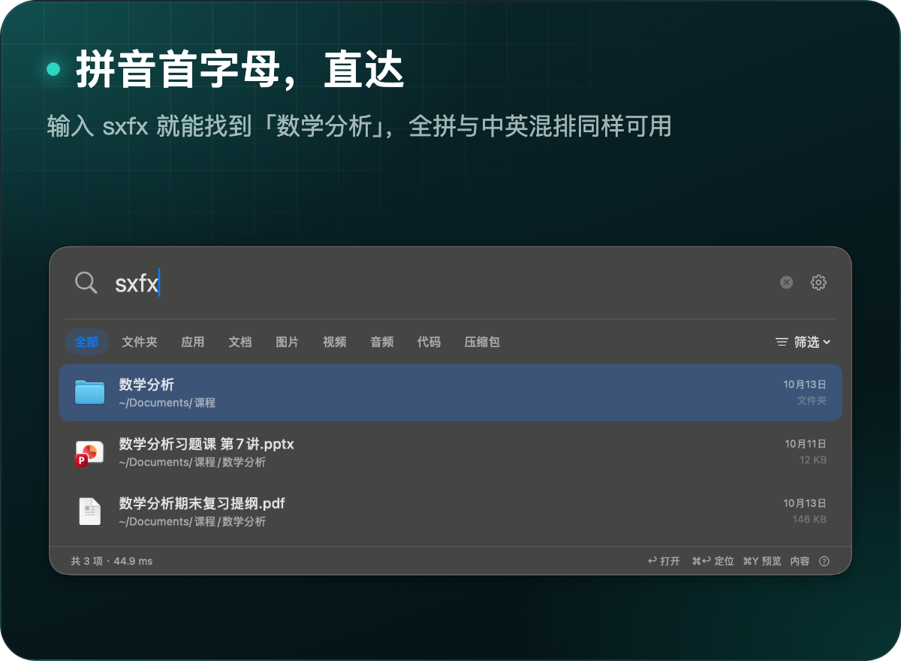
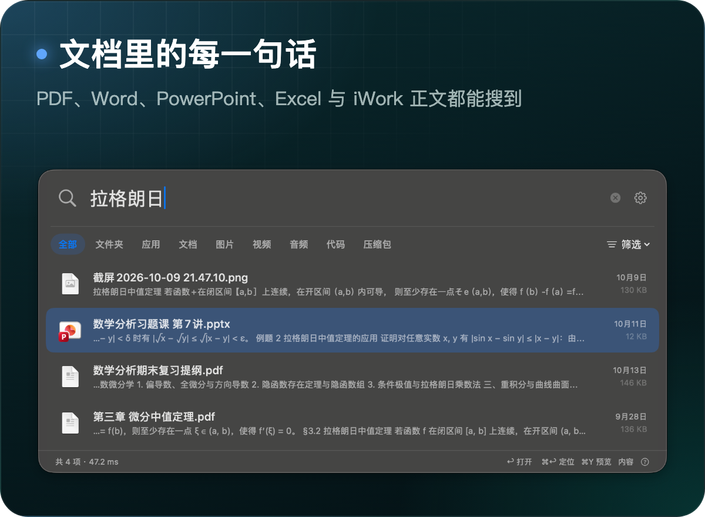
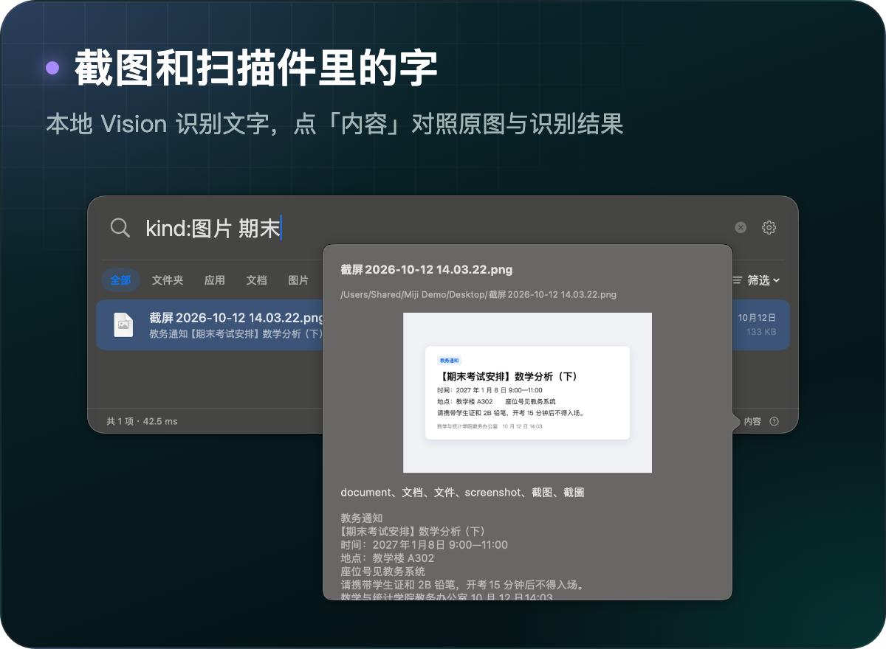
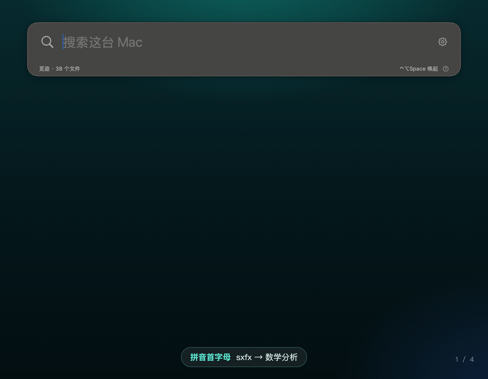
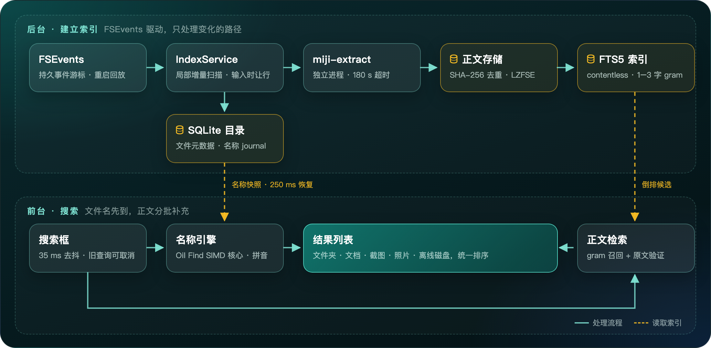
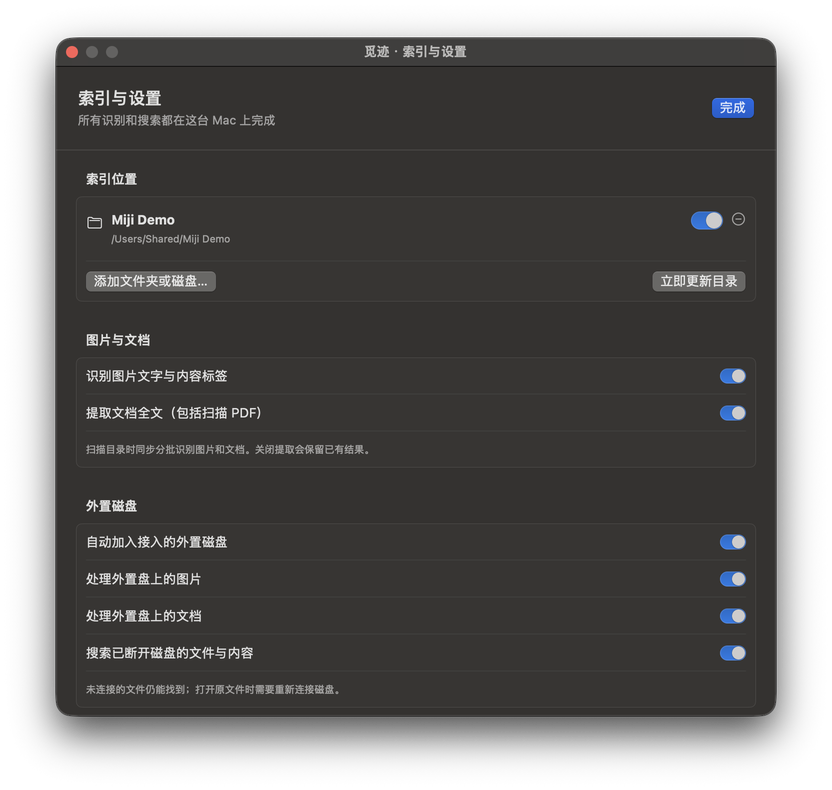

<p align="center">
  
</p>

<p align="center">
  <a href="https://github.com/kbwumin13-sudo/miji/releases/latest"></a>
  
  
  
  
  <a href="LICENSE"></a>
</p>

<p align="center">
  <a href="https://github.com/kbwumin13-sudo/miji/releases/latest"><b>下载</b></a> ·
  <a href="#快速开始"><b>快速开始</b></a> ·
  <a href="#搜索语法"><b>搜索语法</b></a> ·
  <a href="#性能"><b>性能</b></a> ·
  <a href="#工作原理"><b>工作原理</b></a> ·
  <a href="README.en.md"><b>English</b></a>
</p>

按下 `⌃⌥Space`，输入 `sxfx` 找到《数学分析》复习提纲，输入「拉格朗日」翻出课件截图，输入「鸟」找到一张没有任何文字的鹦鹉照片。

**觅迹**是一款原生 macOS 搜索工具，为中文用户设计：文件名、拼音与首字母、PDF 和 Office 文档全文、图片里的文字与内容、已经拔掉的外置盘，都在同一个搜索框里。识别、索引和查询全部在你的 Mac 上完成，不联网。

## 它能找到什么

<p align="center">
  
  
</p>
<p align="center">
  
  
</p>

- **默认覆盖整台 Mac**：从 `/` 开始建立索引，系统目录、隐藏文件和资源库都在范围内；应用包和文档包按一个条目处理。
- **拔掉的外置盘照样能搜**：外置盘按卷 UUID 单独建索引，断开后目录、正文和标签仍保存在本机，结果标为「未连接」；重新接入时自动恢复，挂载路径变了也能认回。
- **边输入边出结果**：文件名结果先显示，正文命中分批补充；改词或收起窗口时，旧查询立即取消。
- **只更新变化的部分**：FSEvents 事件游标持久保存，只重扫发生变化的路径；重启后从上次位置回放，事件丢失时才回退全量扫描。
- **单个文件出错不影响整体**：OCR、PDF 与 iWork 解析在随应用分发的独立进程里逐个运行，单个文件超过 180 秒即终止并记录，后续文件继续处理。

## 边输入，边出结果

<p align="center">
  
</p>
<p align="center"><sub>演示文件为虚构的课程资料；界面、结果与耗时取自觅迹 1.1.0 实机运行。</sub></p>

## 快速开始

1. 从 [Releases](https://github.com/kbwumin13-sudo/miji/releases/latest) 下载 `Miji-1.1.0-macOS-arm64.zip`，解压后把「觅迹.app」拖进「应用程序」。
2. 觅迹使用 ad-hoc 签名，尚未经过 Apple 公证，首次打开时 macOS 会提示无法验证开发者或「已损坏」。在终端执行下面这行后再打开即可；如果只是提示无法验证，也可以先尝试打开一次，再到「系统设置 → 隐私与安全性」底部点「仍要打开」。

   ```sh
   xattr -dr com.apple.quarantine /Applications/觅迹.app
   ```

3. 在「系统设置 → 隐私与安全性 → 完全磁盘访问权限」中启用「觅迹」并重新打开应用，「文稿」「桌面」等受保护目录才会被索引。
4. 按 `⌃⌥Space` 唤起搜索，菜单栏的放大镜也能打开。首次运行先建立文件名目录，期间即可搜索；图片和文档内容在后台分批识别，进度在「索引与设置」中查看。

系统要求：Apple Silicon，macOS 14 或更新版本。

### 快捷键

| 按键 | 操作 |
| --- | --- |
| `⌃⌥Space` | 唤起 / 收起搜索 |
| `↑` `↓` | 选择结果 |
| `Return` | 打开 |
| `⌘Return` 或 `⌘R` | 在 Finder 中显示 |
| `⌘Y`，焦点在结果上时也可按 `Space` | 快速查看（Quick Look） |
| `⌘⇧C` | 复制路径 |
| `⌘F` | 回到搜索框 |
| `⌘,` | 索引与设置 |
| `Esc` 或 `⌘W` | 收起 |

窗口顶部的标签按类型筛选，「筛选」菜单可切换文件名 / 内容范围、索引位置和排序方式；底部「内容」显示该文件在本机保存的文字、标签和提取提示。

## 搜索语法

| 输入 | 效果 |
| --- | --- |
| `数学分析` | 匹配中文文件名、拼音、首字母与正文 |
| `sxfx` / `shuxue` | 拼音首字母 / 全拼 |
| `数学 期末` | 同时包含多个词 |
| `"alpha beta"` | 完整短语 |
| `ext:pdf` | 限定扩展名 |
| `path:课程` | 限定路径 |
| `数学 -草稿` | 排除含「草稿」的结果 |
| `kind:图片 海棠` | 只看图片；也支持 文档、文件夹、视频、音频、代码、压缩包、应用 |

每次最多显示 500 个结果，可以用类型、位置或更多关键词缩小范围。

## 支持的内容

| 内容 | 支持范围 |
| --- | --- |
| 图片文字 | Apple Vision 本地 OCR：PNG、JPEG、HEIC、TIFF、BMP、GIF、WebP，动图只处理首帧 |
| 图片内容 | Vision 分类标签与常用中文别名（鸟、花、海滩、截图、文档……），按标签检索 |
| PDF | 提取文字层，没有文字的页面执行 OCR，扫描版 PDF 同样可搜 |
| Word / PowerPoint / Excel | DOCX 正文、页眉与页脚，PPTX 幻灯片与备注，XLSX 单元格；旧版 DOC 由系统转换，PPT、XLS 由系统即时导入 |
| Pages / Numbers / Keynote | 优先由系统直接解析，失败时从内嵌的 PDF 或预览图提取，这种情况下可能只有部分内容，界面会给出提示 |
| 其他文档 | TXT、Markdown、CSV、HTML、RTF / RTFD、EPUB，以及常见代码与配置文件 |
| 外置盘 | 目录、正文与标签保存在本机，断开后仍可检索；打开原文件需要重新接入 |

单个文件的内容提取上限为 64 MiB 输入、8 MiB 文字，ZIP 解包总量不超过 128 MiB；超出上限时记录提示，文件名照常可搜。未下载到本机的云端占位文件只索引名称，不会触发下载；有密码保护的文档不解密。

## 性能

在 Apple M5（16 GB 内存）上，使用 2,479,232 个真实文件名做基准，每个查询运行 20 轮，统计名称匹配加读取结果的 P95：

| 查询 | 类型 | P95 |
| --- | --- | ---: |
| `数学分析` | 中文 | 9.7 ms |
| `数学` | 中文短词 | 19.5 ms |
| `shuxue` | 全拼 | 28.9 ms |
| `sx` | 首字母 | 49.1 ms |
| `pdf` | 英文 | 70.1 ms |
| `README` | 英文 | 77.5 ms |

- **索引缩小 86%**：1.1.0 按 SHA-256 对正文去重、用 LZFSE 无损压缩，全文索引不再重复保存正文。同一份索引从 51.07 GB 降到 7.28 GB，迁移时 840,123 条已提取内容逐条校验，无一缺失。
- **重启即可用**：名称索引快照 250 ms 内恢复，无需重新扫描。
- **内存占用**：主进程约 200–260 MiB；OCR 与文档解析在按文件启动的 helper 中进行，不计入此数。
- **宽泛的全文查询**需要更长时间完成候选验证和排序：实测多数在 1–15 秒，`README` 这类极常见的词可能超过 30 秒。期间文件名结果和已验证的正文命中会先显示。

## 工作原理

<p align="center">
  
</p>

| 模块 | 职责 |
| --- | --- |
| `MijiApp` | SwiftUI / AppKit 浮窗、菜单栏、全局快捷键、设置窗口与 Quick Look |
| `MijiCore` | 目录扫描、FSEvents 增量更新、SQLite 目录与 FTS5、内容提取调度、索引迁移 |
| `CContentIndex` | 自定义 FTS5 分词器 `miji_grams`：1–3 字符 gram 只负责召回候选，命中再按原文字面验证 |
| `OilFindCore` / `COilFind` | 来自 Oil Find v1.6.2 的 MIT 名称核心（SIMD 字节匹配与拼音表），觅迹在此基础上增加了紧凑名称列与二进制快照 |
| `MijiCLI` | 命令行工具；打包后同时作为单文件提取 helper `miji-extract` |

## 隐私

<table>
<tr>
<td width="56%">
<ul>
<li>源码中没有任何网络请求，不上传文件，也不收集统计数据。</li>
<li>索引保存在 <code>~/Library/Application Support/Miji/</code>，目录权限仅限当前用户读写。</li>
<li>OCR 使用 macOS 自带的 Vision 框架，在本机运行。</li>
<li>图片识别、文档全文、外置盘处理都能在设置里单独关闭，已有结果会保留。</li>
<li>移除一个索引位置只删除对应索引，不会动原文件。</li>
</ul>
</td>
<td></td>
</tr>
</table>

## 从源码构建

需要 macOS 14 以上和 Swift 5.9 工具链（Xcode 15 或更新版本）。

```sh
git clone https://github.com/kbwumin13-sudo/miji.git
cd miji
swift test                                                   # Core 与 App 测试
bash scripts/package.sh                                      # 构建 Release、签名并打包到 output/
python3 scripts/e2e-check.py --cli .build/release/miji-cli   # 端到端检查
```

1.1.0 发布前，127 项 Core 测试（其中 1 项大型基准默认跳过）与 4 项 App 测试全部通过，Release 版命令行端到端检查 52/52 通过，覆盖 OCR、PDF、DOCX、拼音与过滤语法，以及用 APFS 磁盘镜像模拟的外置盘离线与重连。

```text
Sources/
  MijiApp/         浮窗、设置、菜单栏与快捷键
  MijiCore/        索引服务、扫描、FSEvents、SQLite、内容提取
  MijiCLI/         命令行工具与提取 helper
  CContentIndex/   FTS5 n-gram 分词器
Vendor/OilFind/    Oil Find v1.6.2 名称核心（MIT），本地改动见 UPSTREAM.md
Tests/             Core 与 App 测试
scripts/           打包、图标生成、端到端检查
```

## 当前边界

- 只提供 Apple Silicon 版本，需要 macOS 14 或更新。
- 应用为 ad-hoc 签名，尚未公证，首次打开需要手动放行。
- 图片内容搜索基于 Vision 分类标签，不支持任意自然语言描述的语义检索。
- Pages、Numbers、Keynote 新版文件格式的全文完整性还没有用大量真实样本验证。
- 外置盘离线与重连已用 APFS 磁盘镜像自动化测试，实体硬盘的物理插拔尚未系统测试。

## 致谢

名称匹配核心与拼音表来自 [Oil Find](https://github.com/oil-oil/oil-find) v1.6.2（MIT License，Copyright © 2026 Lin Zhihuang），固定的 commit 与本地改动记录在 [Vendor/OilFind/UPSTREAM.md](Vendor/OilFind/UPSTREAM.md)。搜索浮窗的交互参考了 Oil Find 与 macOS 聚焦搜索。

## 许可证

觅迹以 [MIT License](LICENSE) 发布。`Vendor/OilFind` 中的代码沿用其原有的 [MIT License](Vendor/OilFind/LICENSE)，发布包内附带该许可证。
